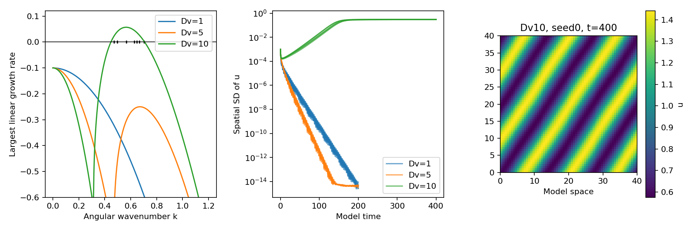
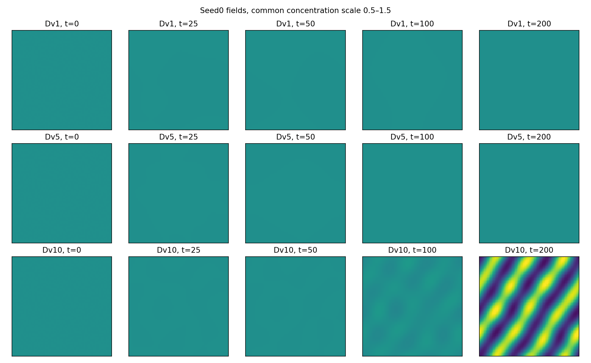

# Reaction–Diffusion Pattern Formation

**Predicting a spatial instability, then testing it numerically.**

I started with two almost uniform concentration fields and asked when a small disturbance would grow. The point of this experiment is to connect a pattern to its stability calculation, rather than explain it by its appearance.



## Prediction → simulation

I use the dimensionless Schnakenberg system on a periodic square:

```text
u_t = ∇²u + 0.1 − u + u²v
v_t = Dv ∇²v + 0.9 − u²v
```

The uniform equilibrium is (1, 0.9). Its reaction Jacobian has trace −0.2 and determinant 1, so local reactions alone are linearly stable. For each spatial mode, I calculate the largest real eigenvalue of `J − k² diag(1, Dv)`.

With Dv = 10, the predicted unstable band is **0.2 < k² < 0.5**. The finite square supports seven distinct squared wavenumbers inside that band. This predicts early amplification; it does not uniquely specify the final nonlinear geometry.

The simulations agree with the qualitative prediction:

| Dv | Runs | Final spatial SD of u | Observation |
|---|---:|---:|---|
| 1 | 5 | Below 10⁻¹⁴ | Perturbations decay |
| 5 | 5 | Below 10⁻¹⁴ | Perturbations decay |
| 10 | 5 | 0.3053–0.3058 | Spatial patterns develop |

All Dv = 10 runs required the declared extension from 200 to 400 time units. Four passed the final settling criterion; **one remained unsettled**. I keep that distinction even though their final spatial standard deviations are similar. The strongest individual Fourier mode gives a wavelength of approximately 11.09 model space units in all five runs.



## Checking the numerical explanation

I update reactions explicitly and diffusion implicitly in Fourier space, using both old concentration fields for each step. Controls preserve the uniform equilibrium, check diffusion-only mean conservation and smoothing, and compare reaction-only evolution with an independent ODE solver. Negative or nonfinite concentrations fail the run; none are clipped.

For Dv = 10 and seed 0, halving the time step changes final spatial SD by about **0.0016%**, with the same dominant wavelength. A separate 64-versus-128 grid comparison uses the same smooth initial disturbance on both grids and also passes the declared tolerances. Matching the initial field matters: fresh pixel noise would change both resolution and the experiment.

## Reproduce and inspect

```bash
python -m venv .venv
source .venv/bin/activate
pip install -r requirements.txt
python analysis.py
python -m unittest discover -s tests -v
```

The script regenerates all 15 primary runs, controls, refinements and figures. The notebook displays saved results. [protocol.md](protocol.md) specifies the seeds, domain, settling rule and tolerances; CSV files preserve each run rather than treating pixels as replicates.

This is a mathematical-biology exploration with simulated data. Periodic boundaries and abstract concentrations are not tissue anatomy, and pattern resemblance does not establish a developmental mechanism. Connecting it to biology would require measured reactions, transport and perturbation responses.

## Reading behind the model

[Turing (1952)](https://www.damtp.cam.ac.uk/user/gold/pdfs/teaching/turing1952.pdf) provides the diffusion-driven instability foundation. [Schnakenberg (1979)](https://pubmed.ncbi.nlm.nih.gov/537379/) provides the reaction-system context; [Sigurd Angenent's model notes](https://people.math.wisc.edu/~angenent/519.2016s/notes/Schnakenberg.html) guided the equilibrium and dimensionless formulation. No external dataset is used.
